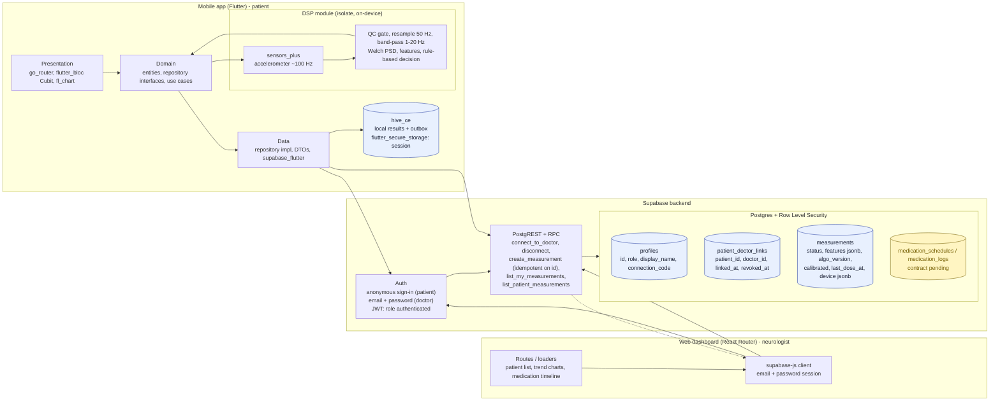

# NuroPulse

NuroPulse is a **patient-to-neurologist companion ecosystem for patients with Parkinson’s** that turns quick daily check-ins into clear insights shared with their neurologists through **medicine logging** and a **biomarker-based Parkinson's tremor detection**.

Built with O(∩_∩)O for JOINTS Hackathon 2026 ⚙️

## System Architecture

## How it works

1. A patient opens the mobile app and runs a short tremor check with the phone resting on a supported hand. No sign-up is needed to start, and the app works offline.
2. An on-device signal processing module filters the accelerometer data, analyzes its frequency spectrum, and applies a transparent, rule-based decision, so every result can be explained and thresholds can be tuned without any black-box model. Raw sensor signals never leave the phone.
3. Once the patient links to their neurologist with a connection code, the extracted features and result sync to the backend, and the medication schedule set by the doctor on the web dashboard appears as reminders in the app. Dose logging is captured on the phone too.
4. The dashboard presents each patient's tremor trend alongside medication timing, closing the loop between screening, treatment, and monitoring, so neurologists review objective patterns between clinic visits instead of relying on memory alone.

## Deployments

The NuroPulse web dashboard can be accessed [here](https://nuropulse-dashboard.vercel.app/). The mobile app (for now, only the Android APK build is released) can be installed from [here](https://github.com/NuroPulse/nuropulse-mobile/releases), download the latest .apk file to your Android phone, and install it.

## Demo

To ease the process of testing, we have seeded a couple of users in the backend:
| Email | Password | Full Name | Role |
| --- | --- | --- | --- |
| `mzidanek@gmail.com` | `test1234` | Mohammad Zidane Kurnianto | Patient (via the mobile app) |
| `jikamaka@gmail.com` | `jikamaka123` | dr. Nuro Surpulsman, Sp.N | Doctor (via the web dashboard) |

## Team

Built by **nama timnya apa**, a 4-person team for JOINTS Hackathon 2026 from the Faculty of Computer Science, Universitas Indonesia 💾

| | Name | Institution | Role |
| :-: | --- | --- | --- |
|  | **Risyad Athaya Muhammad** | Information Systems '25 @ Universitas Indonesia | **Team Leader** & Backend Engineer |
|  | **Mohammad Zidane Kurnianto** | Information Systems '25 @ Universitas Indonesia | Mobile Engineer |
|  | **Rayna Kayla Rayvanka** | Computer Science '25 @ Universitas Indonesia | Business Lead |
|  | **Tania Ju** | Information Systems '25 @ Universitas Indonesia | Frontend Engineer |

## References

### Parkinson screening module

**Signal processing**
- Welch, P. D. (1967). The use of fast Fourier transform for the estimation of power spectra: a method based on time averaging over short, modified periodograms. *IEEE Transactions on Audio and Electroacoustics*, 15(2), 70–73.
- SciPy documentation. `scipy.signal.welch`, `butter`, `sosfiltfilt`. https://docs.scipy.org/doc/scipy/reference/signal.html

**Tremor characterization**
- Deuschl, G., Bain, P., & Brin, M. (1998). Consensus statement of the Movement Disorder Society on Tremor. *Movement Disorders*, 13(Suppl 3), 2–23.
- Bhatia, K. P., et al. (2018). Consensus statement on the classification of tremors, from the Task Force on Tremor of the International Parkinson and Movement Disorder Society. *Movement Disorders*, 33(1), 75–87.

**Accelerometer-based Parkinson's data**
- Varghese, J., et al. (2024). Machine learning in the Parkinson's disease smartwatch (PADS) dataset. *npj Parkinson's Disease*, 10, 9. https://www.nature.com/articles/s41531-023-00625-7

### Problem context
- ANTARA (2 May 2026). PERDOSNI siap isi kebutuhan dokter saraf RS di daerah. https://www.antaranews.com/berita/5551344/perdosni-siap-isi-kebutuhan-dokter-sarafrs-di-daerah

### Implementation
- sensors_plus (Flutter accelerometer package). https://pub.dev/packages/sensors_plus
